<div align="center">


### AI-powered urban infrastructure monitoring & decision-support system
**See the problem → understand it → score the risk → prioritize → act → track**

[](#-license)


**[🌐 Live App](https://nece-city.vercel.app) · [⚙️ API Docs](https://nececity-backend.onrender.com/docs) · [📦 Repository](https://github.com/Oliveya-15/NeceCity)**

</div>

<br/>

> *"Cities don't fail all at once. They fail one unreported pothole at a time."*

<br/>

## 📑 Table of Contents

- [📖 The Idea Behind NeceCity](#-the-idea-behind-nececity)
- [🎯 The Problem](#-the-problem)
- [✨ What NeceCity Does](#-what-nececity-does)
- [🖼️ Screenshots](#️-screenshots)
- [🧠 How Problem Detection Works](#-how-problem-detection-works)
- [⚖️ The Explainable Risk Engine](#️-the-explainable-risk-engine)
- [🏗️ Architecture & Workflow](#️-architecture--workflow)
- [🔁 The Model Training Loop](#-the-model-training-loop)
- [🛠️ Tech Stack](#️-tech-stack)
- [☁️ Free Deployment Setup](#️-free-deployment-setup)
- [🚀 Live Demo](#-live-demo)
- [⚡ Getting Started](#-getting-started)
- [🔧 Environment Variables](#-environment-variables)
- [🔌 API Overview](#-api-overview)
- [📁 Project Structure](#-project-structure)
- [🧪 Demo Data & Honest Limitations](#-demo-data--honest-limitations)
- [🗺️ Roadmap](#️-roadmap)
- [📄 License](#-license)
- [🙏 Acknowledgments](#-acknowledgments)

<br/>

---

## 📖 The Idea Behind NeceCity

Most city problems are noticed the same way: someone complains, someone posts a photo, or a news report goes viral. Municipalities end up reacting to whatever is loudest, not whatever is most dangerous.

NeceCity started from a simple question: **what if a street photo could tell a city exactly where its riskiest infrastructure problems are, and what to fix first?**

The answer became a full pipeline rather than a single model. A computer-vision model spots the problem, a human confirms it, a transparent scoring formula ranks it against everything else in the city, and a workflow tracks it from *Detected* all the way to *Resolved*.

Two rules shaped every decision in this project:

1. **No fake AI.** Every confidence value comes from a real model, every score from a documented formula, and when something isn't available the app says so instead of inventing an answer.
2. **A human always has the last word.** Nothing the model predicts becomes a stored problem until a person confirms it.

<br/>

---

## 🎯 The Problem

| | |
|---|---|
| **Reactive reporting** | Authorities learn about problems from complaints, not from systematic monitoring. |
| **No way to compare** | A pothole on a quiet lane and a pothole outside a hospital look the same on a complaint list. |
| **Duplicate reports** | The same problem is reported many times, hiding how long it has actually been ignored. |
| **No pattern visibility** | Individual reports hide the clusters, trends and repeat offenders that point to deeper failures. |
| **Citizens don't know who to contact** | Even a motivated resident rarely knows which organization can actually help. |

**NeceCity's answer:** upload a street photo, let a locally-run YOLO model detect the problem, confirm it, and get an explainable priority score, a place on a live city map, analytics that reveal hotspots and trends, and a tracked path to resolution.

<br/>

---

## ✨ What NeceCity Does

<p align="center">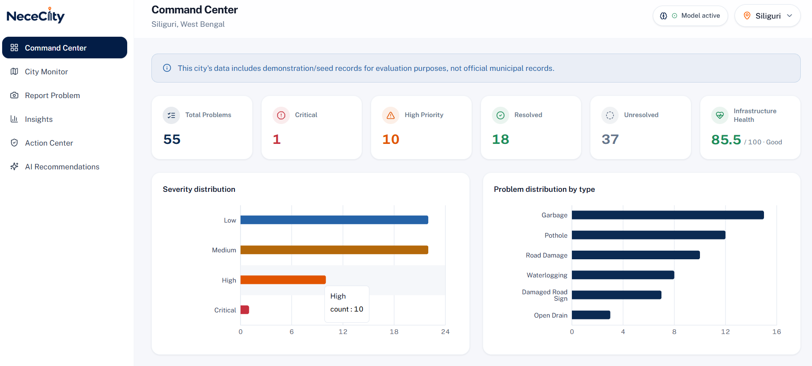</p>
<p align="center"><sub><strong>Command Center</strong>: the home page, with city health, breakdowns and top priorities at a glance</sub></p>

- 📊 **Command Center:** a city-wide overview with totals, severity / status / type breakdowns, an infrastructure health score, top priorities and recent critical detections.
- 🗺️ **City Monitor:** an interactive Leaflet + OpenStreetMap map with type, severity, status, ward and date filters, plus a detail panel for any location.
- 📷 **Report Problem:** upload a street photo, run local YOLO inference, review bounding boxes with confidence scores and a suggested severity, then **Confirm, Reject or Edit** before anything is saved. Missed something? Draw the region yourself, or log a problem manually when no model is available.
- 📈 **Insights:** real data-science analytics, including weekly/monthly trends (pandas), DBSCAN hotspot clustering (scikit-learn), recurring-problem detection and plain-language "Data Insight" statements that trace back to real numbers.
- 🛡️ **Action Center:** a risk-ranked priority queue, a problem lifecycle (*Detected → Verified → In Progress → Resolved*) and one-click **PDF / CSV** reports.
- 🤖 **AI Recommendations:** a chat assistant grounded in your city's real data (LLM-backed when a key is configured, a data-driven rule-based assistant otherwise), plus a directory of verified civic organizations and practical civic tips.
- 🏙️ **Multi-city by design:** every city is a database row, not a code constant, so adding a city never requires touching the source.
- 🔁 **Duplicate-aware:** confirming a problem within 30 m of an existing unresolved one of the same type increases its recurrence count instead of creating a duplicate.
- 🟢 **Always-visible model status:** a badge in the top bar shows whether the ML model is loaded, on every page.

<br/>

---

## 🖼️ Screenshots

> The **Command Center** (home page) screenshot is shown at the top of [What NeceCity Does](#-what-nececity-does).

<table>
<tr>
<td width="50%">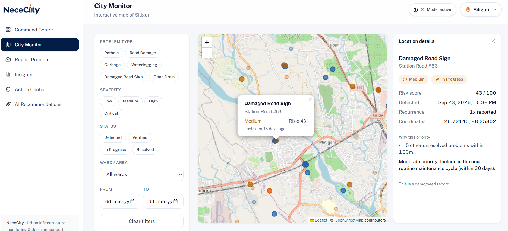<p align="center"><sub><strong>City Monitor</strong>: live filtered map of every reported problem</sub></p></td>
<td width="50%">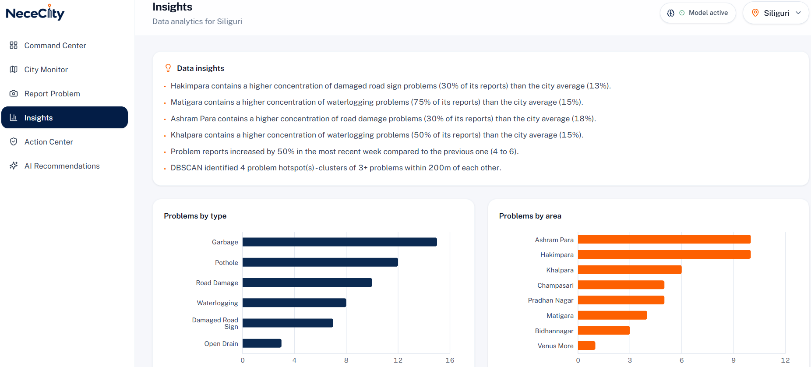<p align="center"><sub><strong>Insights</strong>: trends, hotspot clusters and recurring problems</sub></p></td>
</tr>
<tr>
<td width="50%">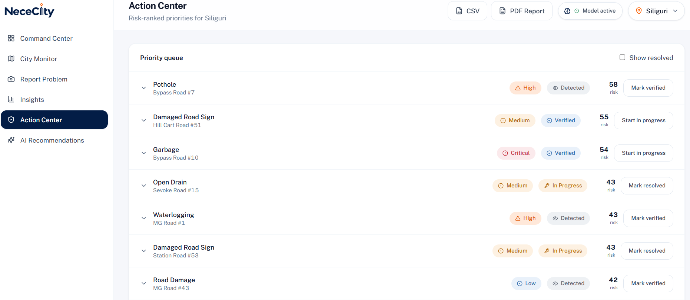<p align="center"><sub><strong>Action Center</strong>: explainable risk-ranked priority queue and reports</sub></p></td>
<td width="50%">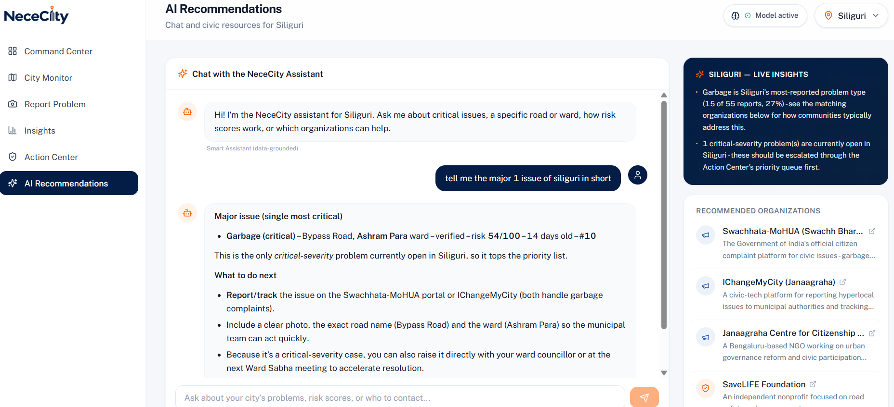<p align="center"><sub><strong>AI Recommendations</strong>: data-grounded chat and verified civic organizations</sub></p></td>
</tr>
</table>

### 📷 Report Problem: desktop and mobile

<p align="center">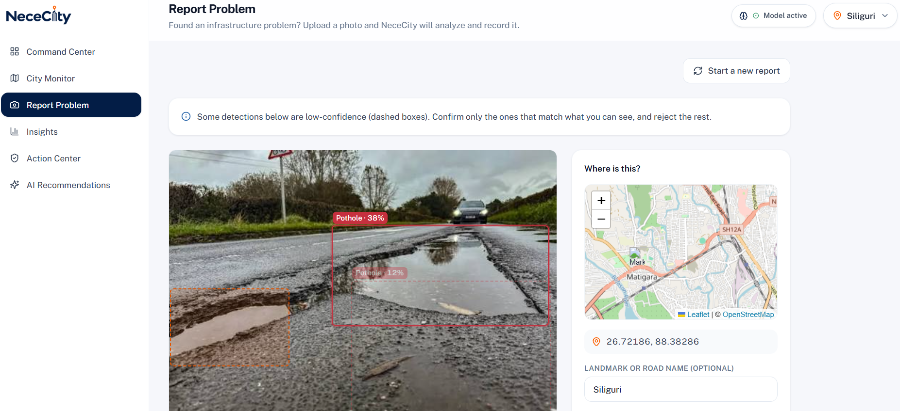</p>
<p align="center"><sub><strong>Desktop</strong>: upload a photo, review YOLO detections with confidence scores, then Confirm, Reject or Edit</sub></p>

<table align="center">
<tr>
<td align="center" width="50%">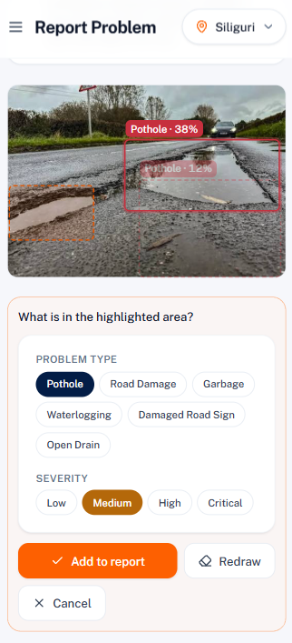<p><sub><strong>Mobile (1/2)</strong>: upload and detection results</sub></p></td>
<td align="center" width="50%">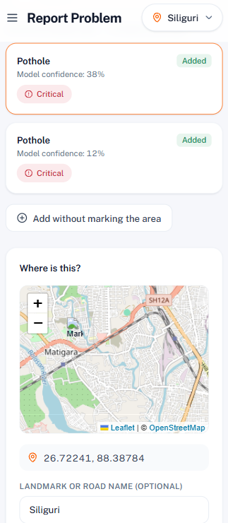<p><sub><strong>Mobile (2/2)</strong>: review, severity and confirmation</sub></p></td>
</tr>
</table>

<p align="center"><sub>📱 The layout is responsive, so problems can be reported straight from a phone in the field.</sub></p>

<br/>

---

## 🧠 How Problem Detection Works

<p align="center">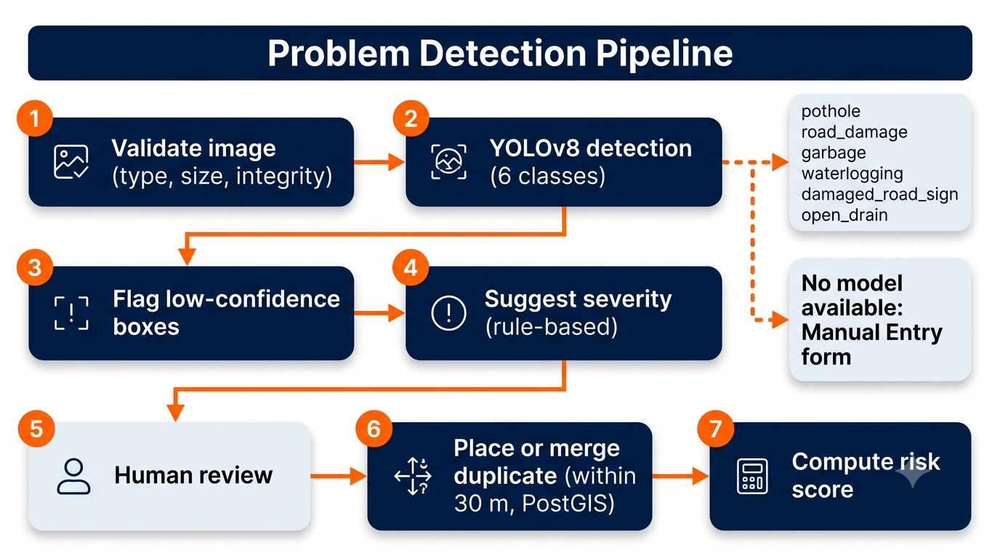</p>

Every uploaded photo walks the same pipeline, and a person is always in the loop:

| # | Stage | What happens |
|---|---|---|
| 1 | **Validate** | File type (JPEG / PNG / WebP), size limit (8 MB) and image integrity are checked with Pillow before anything else. |
| 2 | **Detect** | The project's own YOLOv8n model runs locally (no external AI API) and finds up to 6 problem classes: `pothole`, `road_damage`, `garbage`, `waterlogging`, `damaged_road_sign`, `open_drain`. |
| 3 | **Flag uncertainty** | Boxes above the confidence threshold are shown normally. Boxes between a low floor and the threshold are still shown, but marked **"low confidence, please verify"** rather than silently hidden. |
| 4 | **Suggest severity** | A documented, deterministic heuristic (class weight + relative box area) pre-fills a severity. It is explicitly *not* a second ML model, and the reviewer can always change it. |
| 5 | **Human review** | The reviewer **Confirms, Rejects or Edits** each detection, or draws a region the model missed. |
| 6 | **Place or merge** | A confirmed detection becomes a tracked **Problem**. If an unresolved problem of the same type exists within 30 m (PostGIS `ST_DWithin`), its recurrence count increases instead of creating a duplicate. |
| 7 | **Score** | The risk engine computes an explainable score for the problem (see below). |

**Graceful degradation:** if no model file is present, the app does not crash. It reports `model not configured`, every other page keeps working, and the **Manual Entry** form lets you log a problem directly.

<br/>

---

## ⚖️ The Explainable Risk Engine

<p align="center">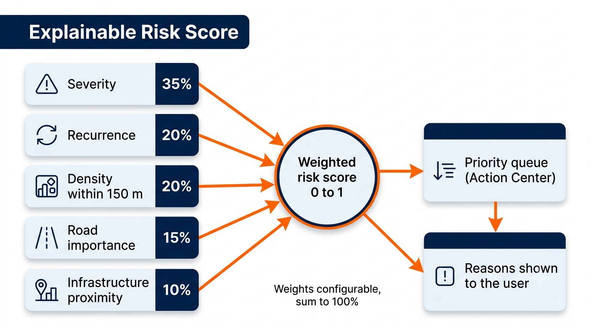</p>

Priority is never a hidden number. Each problem gets a **0 to 1 risk score** from five weighted factors, and the Action Center shows *why* a problem ranks where it does.

| Factor | Weight | What it measures |
|---|---|---|
| **Severity** | 0.35 | Low, Medium, High or Critical, as confirmed by the reviewer |
| **Recurrence** | 0.20 | How many confirmed detections have landed on or near this spot |
| **Density** | 0.20 | How many other problems lie within 150 m (real metres via PostGIS `geography`) |
| **Road importance** | 0.15 | Local street, arterial road or highway |
| **Infrastructure proximity** | 0.10 | Whether it is near critical infrastructure such as a hospital, school or major junction |

Weights live in configuration, are validated to sum to 1.0 at startup, and every stored score records the formula version that produced it. The score is recomputed whenever a problem's status changes, so it always reflects the current state of the neighbourhood.

<br/>

---

## 🏗️ Architecture & Workflow

<p align="center">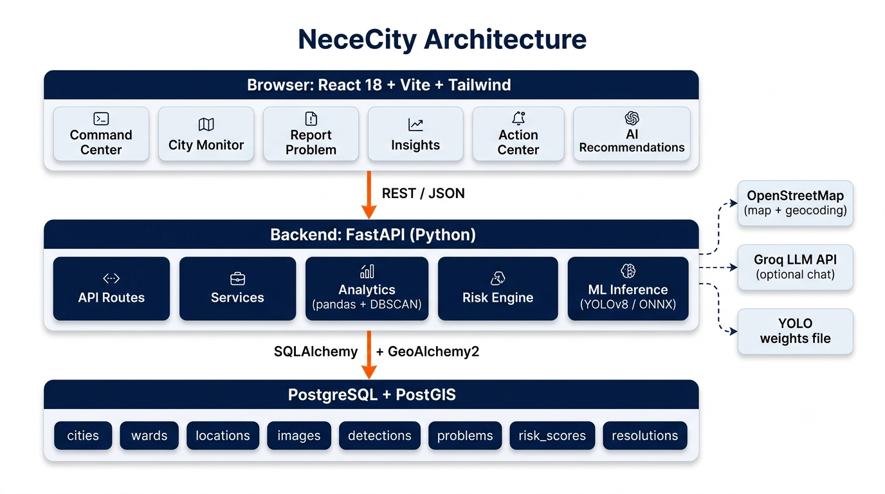</p>

<p align="center">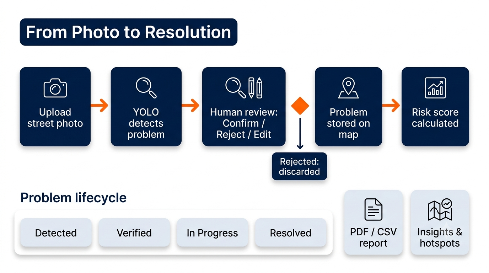</p>

NeceCity is a **modular monolith**: one backend process, one database, one frontend build. Every concern lives in its own folder, so any part can be read, tested or replaced on its own.

| Layer | Responsibility |
|---|---|
| `api/routes/` | Thin HTTP handlers only, with no business logic |
| `services/` | Orchestration: detection → problem, city summaries, reports, chat |
| `analytics/` | Data science: pandas trends, scikit-learn DBSCAN hotspots, recurring-problem detection |
| `risk/` | The explainable weighted scoring engine |
| `ml/` | YOLO inference wrapper with graceful degradation |
| `models/` + `schemas/` | SQLAlchemy ORM + Pydantic contracts |

**Where every number on screen comes from:** city stats, map markers and charts are live SQL queries; trends are pandas on real timestamps; hotspots are DBSCAN on real coordinates; detections are real model output or an honest "not available". Full data-flow map in [`ARCHITECTURE.md`](ARCHITECTURE.md).

<br/>

---

## 🔁 The Model Training Loop

<p align="center">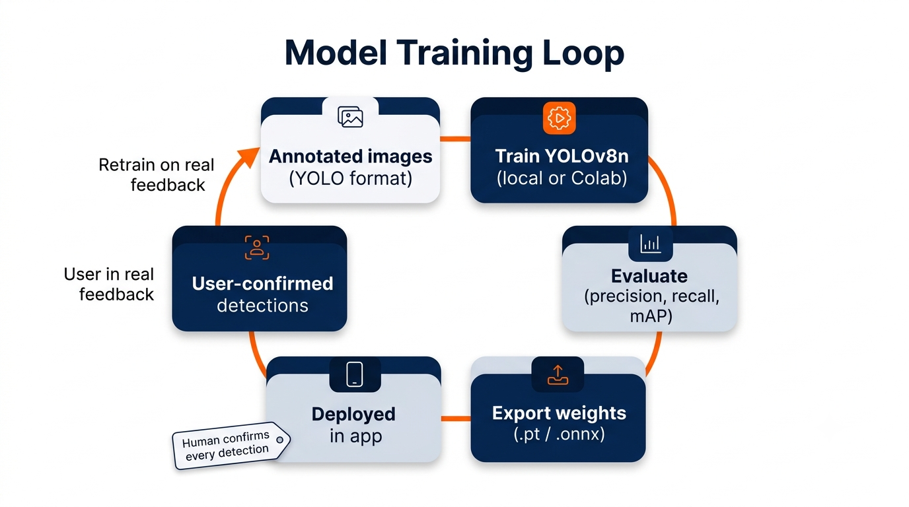</p>

The ML pipeline is deliberately separate from the web app, so training never affects what is running.

1. **Prepare data:** images and YOLO-format labels are validated against a single shared class list (`ml/data/classes.yaml`).
2. **Train:** YOLOv8n with transfer learning, locally or on Google Colab (`notebooks/NeceCity_Training_Colab.ipynb`).
3. **Evaluate:** real precision, recall and mAP numbers from `ml/evaluation/evaluate.py`.
4. **Deploy weights:** the best checkpoint goes to `ml/weights/`, and the backend loads it at startup.
5. **Learn from users:** every detection a reviewer confirms (and every region they draw) is stored. `ml/training/export_feedback.py` turns these into new training data, so the model improves on exactly the kind of photos your users upload. Only **confirmed** detections are ever exported.

A provenance file (`nececity_yolo.meta.json`) records what the model was trained on, and the app shows an honest warning if a model was trained only on synthetic placeholder data.

<br/>

---

## 🛠️ Tech Stack

<p align="center">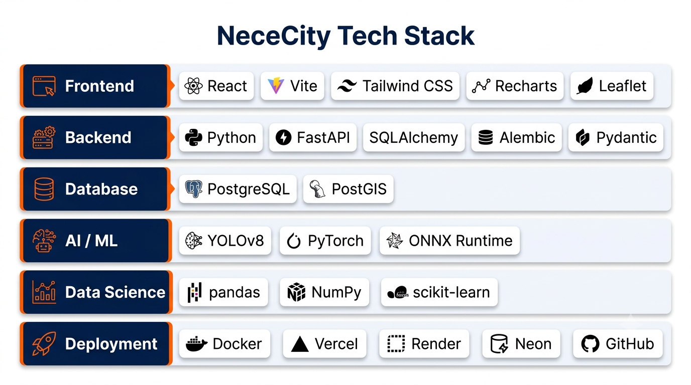</p>

<table>
<tr><th>Layer</th><th>Technology</th></tr>
<tr><td>Frontend</td><td>React 18 · Vite · React Router · Tailwind CSS · Recharts · Leaflet + OpenStreetMap · Lucide icons</td></tr>
<tr><td>Backend</td><td>Python · FastAPI · Pydantic · SQLAlchemy · Alembic</td></tr>
<tr><td>Database</td><td>PostgreSQL 16 + PostGIS 3 (GeoAlchemy2, GIST spatial indexes)</td></tr>
<tr><td>Computer Vision</td><td>YOLOv8n (Ultralytics, PyTorch) for training · ONNX Runtime for lightweight production inference</td></tr>
<tr><td>Data Science</td><td>pandas · NumPy · scikit-learn (DBSCAN) · Shapely</td></tr>
<tr><td>Reporting</td><td>ReportLab (PDF) · Python <code>csv</code></td></tr>
<tr><td>AI Chat</td><td>Any OpenAI-compatible LLM API (Groq in production) with a rule-based fallback</td></tr>
<tr><td>Geocoding</td><td>OpenStreetMap Nominatim (free, no key)</td></tr>
<tr><td>Containers</td><td>Docker + Docker Compose</td></tr>
<tr><td>Deployment</td><td>Vercel (frontend) · Render (backend) · Neon (PostgreSQL + PostGIS)</td></tr>
</table>

**No paid service is required anywhere in this stack.** The map, geocoder, model inference and database all run free.

<br/>

---

## ☁️ Free Deployment Setup

<p align="center">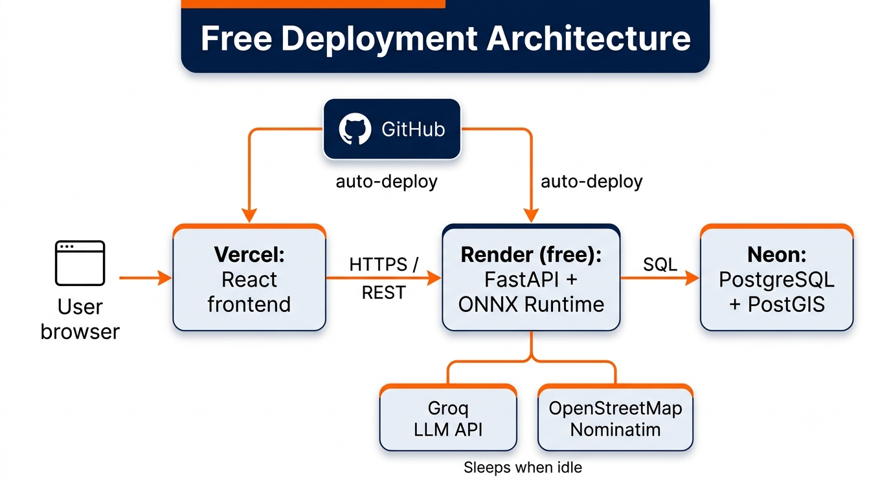</p>

| Part | Host | Why |
|---|---|---|
| Frontend | **Vercel** | Free static hosting, auto-deploys from GitHub |
| Backend | **Render** (free web service, 512 MB) | Runs FastAPI directly from the repository |
| Database | **Neon** (free Postgres with PostGIS) | The app needs real spatial queries, so a plain database would not work |
| Chat LLM | **Groq** (free tier) | OpenAI-compatible API, configured through environment variables |

**The one important engineering decision:** the training stack (PyTorch + Ultralytics) needs far more than 512 MB of RAM just to import. For production, the YOLO model is exported to **ONNX** and served with **ONNX Runtime**, which fits comfortably in a free tier. The backend picks the engine automatically from the model file extension (`.pt` uses Ultralytics, `.onnx` uses ONNX Runtime), so local development and Docker are unchanged.

Export command:

```bash
yolo export model=ml/weights/nececity_yolo.pt format=onnx imgsz=640 opset=12
```

Production uses the slim `backend/requirements-deploy.txt` (no torch, no OpenCV, no GeoPandas).

> ⏳ The backend is on Render's free tier, so the first request after a period of inactivity can take about a minute to wake up. That is infrastructure, not a bug.

<br/>

---

## 🚀 Live Demo

| | |
|---|---|
| 🌐 **App** | [nece-city.vercel.app](https://nece-city.vercel.app) |
| ⚙️ **API docs** | [nececity-backend.onrender.com/docs](https://nececity-backend.onrender.com/docs) |
| 📦 **Source** | [github.com/Oliveya-15/NeceCity](https://github.com/Oliveya-15/NeceCity) |

> 🏙️ **Siliguri** and **Kolkata** contain demo data. The other cities in the selector are marked **Demo** and have no data yet.

<br/>

---

## ⚡ Getting Started

### Option 1: Docker (fastest, runs database + backend + frontend)

```bash
git clone https://github.com/Oliveya-15/NeceCity.git
cd NeceCity
cp .env.example .env
docker compose up --build
```

Then open:

- **App:** http://localhost:8080
- **API docs:** http://localhost:8000/docs

The backend container applies migrations and seeds demo data on first start.

### Option 2: Manual setup

```bash
# 1. Database (PostgreSQL + PostGIS)
docker run -d --name nececity-db \
  -e POSTGRES_USER=nececity -e POSTGRES_PASSWORD=nececity -e POSTGRES_DB=nececity \
  -p 5432:5432 postgis/postgis:16-3.4

# 2. Backend
cd backend
python -m venv .venv && .venv\Scripts\activate      # Windows
pip install -r requirements.txt
cp .env.example .env
python -m alembic upgrade head
python -m app.seed.seed_data
uvicorn app.main:app --reload --port 8000

# 3. Frontend (new terminal)
cd frontend
npm install
cp .env.example .env
npm run dev                                         # http://localhost:5173
```

### Training your own model

```bash
cd ml
pip install -r requirements.txt
python data/validate_dataset.py --dataset data/real_dataset --classes data/classes.yaml
cd training && python train.py
cd ../evaluation && python evaluate.py --weights ../training/runs/detect/nececity_yolo/weights/best.pt --dataset ../training/dataset.yaml
```

Copy the resulting `best.pt` to `ml/weights/nececity_yolo.pt` and restart the backend. Details: [`ml/data/README.md`](ml/data/README.md) and [`ml/weights/README.md`](ml/weights/README.md).

Run the backend tests with `pytest` from inside `backend/`.

<br/>

---

## 🔧 Environment Variables

| Variable | Used by | Purpose |
|---|---|---|
| `DATABASE_URL` | Backend | Full SQLAlchemy URL (`postgresql+psycopg2://...`). Overrides the `POSTGRES_*` values. |
| `POSTGRES_USER` / `PASSWORD` / `DB` / `HOST` / `PORT` | Backend | Individual database settings (convenient for Docker Compose) |
| `MODEL_PATH` | Backend | Path to the weights (`.pt` for Ultralytics, `.onnx` for ONNX Runtime) |
| `MODEL_CONFIDENCE_THRESHOLD` | Backend | Confidence above which a detection counts as confident |
| `MODEL_USE_TTA` | Backend | Test-time augmentation (slower, more robust; not available with ONNX) |
| `CORS_ORIGINS` | Backend | JSON list of allowed frontend origins |
| `LLM_API_KEY` / `LLM_API_BASE_URL` / `LLM_MODEL` | Backend | Optional. Enables the LLM-backed chat. Leave the key empty for the rule-based assistant. |
| `RISK_WEIGHT_*` | Backend | The five risk weights (must sum to 1.0) |
| `VITE_API_BASE_URL` | Frontend | Backend API base URL, baked in at build time |

Every variable is documented in the `.env.example` files. **No secrets are committed.**

<br/>

---

## 🔌 API Overview

Interactive docs are generated by FastAPI at `/docs`. Route groups under `/api/v1`:

| Group | Purpose |
|---|---|
| `/cities` | City list and per-city summaries |
| `/map` | Filtered problem markers for City Monitor |
| `/analyze` · `/detections` | Image upload, YOLO inference, confirm / reject / edit |
| `/problems` | Problem records, manual entry and status changes |
| `/analytics` | Overview, trends and hotspot clusters |
| `/risk` | Risk scores and the priority queue |
| `/reports` | PDF and CSV exports |
| `/recommendations` · `/chat` | City insights, civic organizations and the chat assistant |
| `/ml` | Live model status |
| `/health` | Health check |

<br/>

---

## 📁 Project Structure

```
nececity/
├── backend/            FastAPI app, SQLAlchemy models, Alembic migrations, tests
│   └── app/
│       ├── api/routes/     thin route handlers
│       ├── services/       business logic
│       ├── analytics/      pandas + DBSCAN (Insights)
│       ├── risk/           explainable risk engine
│       ├── ml/             YOLO / ONNX inference wrapper
│       ├── models/         SQLAlchemy ORM
│       ├── schemas/        Pydantic contracts
│       └── seed/           demo data generator
├── frontend/           React + Vite + Tailwind app (6 pages)
├── ml/                 Training pipeline, separable from the web app
│   ├── data/               classes, datasets, validator
│   ├── training/           train.py, feedback export
│   ├── evaluation/         evaluate.py
│   ├── inference/          standalone predict.py
│   └── weights/            trained model + provenance file
├── notebooks/          Google Colab training notebook
├── scripts/            utility scripts
├── public/             README images
├── docker-compose.yml
├── ARCHITECTURE.md     full architecture and data-flow reference
└── README.md
```

<br/>

---

## 🧪 Demo Data & Honest Limitations

This project is open about what is real and what is not.

- **Demo data is labeled.** About 100 sample problems are generated for Siliguri and Kolkata. Every demo row has `is_demo = true`, and the UI says so. They are not real municipal records.
- **The model is trained on a small real dataset.** It works as a working proof of the full pipeline, but it is not a production-grade detector. Accuracy would improve with more annotated images, and the built-in feedback loop exists for exactly that.
- **No authentication yet.** Anyone with access to the app can act on data. Role-based access is on the roadmap.
- **Uploaded photos on the free host are not permanent.** Render's free disk resets on restart, so uploaded images can disappear. Database records are unaffected.
- **Hotspot and trend analytics need data.** Very small or fresh cities will show sparse insights.
- **Civic organization directory:** every organization links to its own official website. No local phone numbers or addresses are listed, because a wrong contact detail for a real organization would mislead someone.

<br/>

---

## 🗺️ Roadmap

- [ ] Authentication and role-based access (citizen, reviewer, municipal officer)
- [ ] Real data for more cities
- [ ] Active learning: surface the photos the model is least sure about for annotation
- [ ] Instance segmentation for precise damage area
- [ ] Video and dashcam analysis
- [ ] Predictive risk modelling (where problems are likely to appear next)
- [ ] Assignment of problems to municipal departments
- [ ] Scheduled and emailed reports
- [ ] Persistent image storage (object storage) for deployed environments

<br/>

---

## 📄 License

Released under the [MIT License](LICENSE). Adapt freely for coursework, portfolio or further development.

<br/>

## 🙏 Acknowledgments

- **Ultralytics**, for YOLOv8
- **OpenStreetMap** contributors, for the free map tiles and Nominatim geocoding
- **PostGIS**, **FastAPI**, **React** and the wider open-source community this project stands on
- Everyone who reviewed and tested NeceCity along the way

<br/>

<div align="center">

**Built end to end: research, design, machine learning, code and deployment.**

<sub>NeceCity · MCA Minor Project · 2026</sub>

</div>
